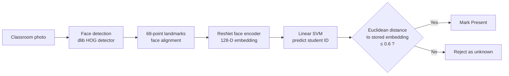
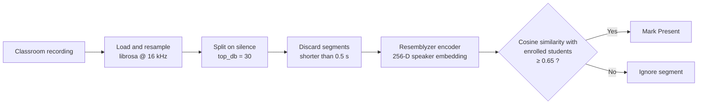
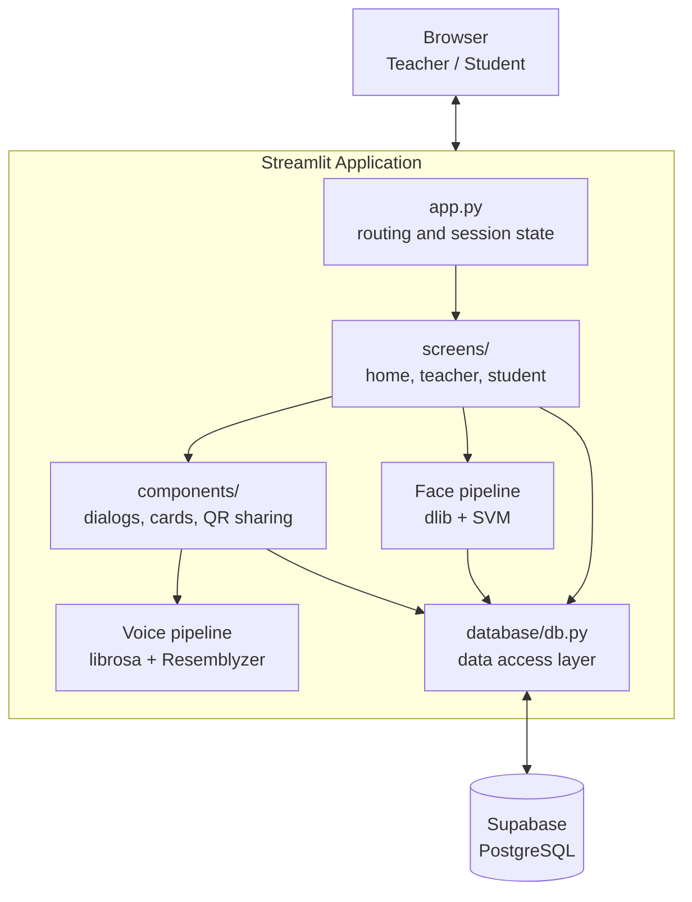
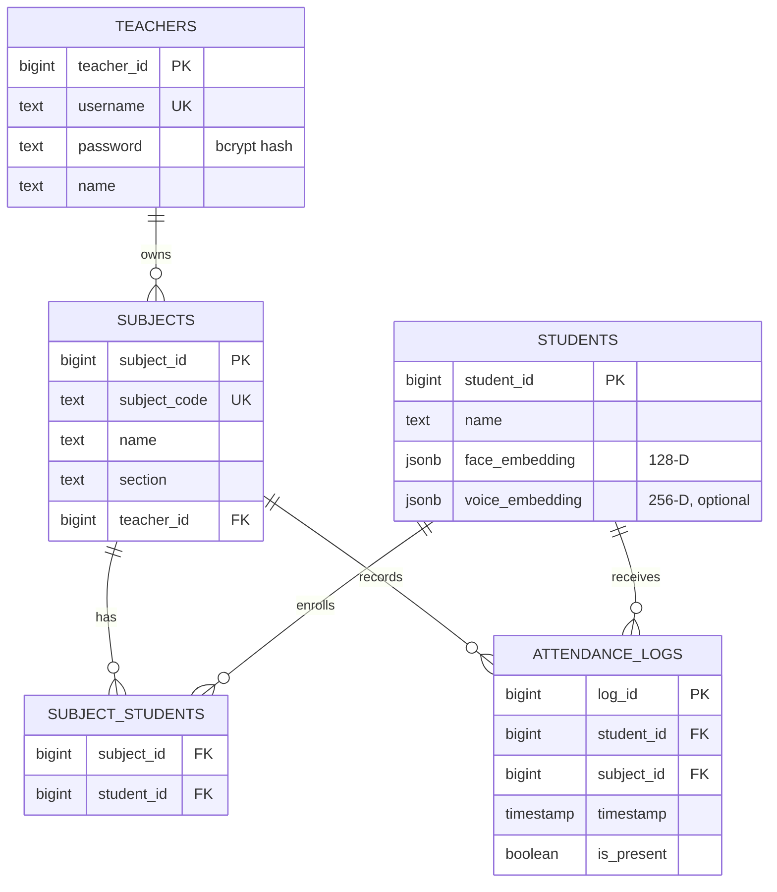

<div align="center">


# SnapClass

### AI-powered classroom attendance using face and voice recognition

Take attendance for an entire class from **a single photo** or **a short voice recording**, in seconds instead of minutes.

[](https://www.python.org/)
[](https://streamlit.io/)
[](https://supabase.com/)
[](http://dlib.net/)
[](https://scikit-learn.org/)
[](https://github.com/resemble-ai/Resemblyzer)

**[Live Demo](https://snapclass-proj.streamlit.app)**

</div>

---

## Table of Contents

- [Overview](#overview)
- [Key Features](#key-features)
- [How the AI Works](#how-the-ai-works)
  - [Face Recognition Pipeline](#1-face-recognition-pipeline)
  - [Voice Recognition Pipeline](#2-voice-recognition-pipeline)
- [System Architecture](#system-architecture)
- [Tech Stack](#tech-stack)
- [Database Schema](#database-schema)
- [Project Structure](#project-structure)
- [Getting Started](#getting-started)
- [Usage](#usage)
- [Evaluation and Benchmarks](#evaluation-and-benchmarks)
- [Design Decisions](#design-decisions)
- [Limitations and Roadmap](#limitations-and-roadmap)

---

## Overview

Manual roll calls waste 5–10 minutes of every lecture and are easy to game through proxy attendance. **SnapClass** replaces that process with computer vision and speech AI:

- A **teacher** captures or uploads one or more classroom photos. SnapClass detects every face, identifies each enrolled student, and produces a Present/Absent report that the teacher reviews before saving.
- When photos are not practical (poor lighting, faces hidden), the teacher can **record students saying "I am present"**, and SnapClass identifies each speaker by voice.
- **Students log in with their face** instead of a password, and new students are registered on the spot.

The system stores **only numerical embeddings, never raw photos or audio**, which keeps it lightweight and privacy-conscious.

<!-- Add screenshots or a GIF of the app here, for example:
<p align="center">
  
  
</p>
-->

---

## Key Features

### For Teachers
- **Secure accounts:** username/password authentication with **bcrypt** password hashing.
- **Subject management:** create subjects with a code, name, and section, and track enrolled students and classes held.
- **Photo attendance:** capture photos with the camera or upload multiple images. Each student is matched across all photos, and the report shows which photo they were found in.
- **Voice attendance:** record the classroom once, and each speaker is identified automatically.
- **Human-in-the-loop review:** every AI result is shown as a table to **confirm or discard** before anything is written to the database.
- **One-tap sharing:** a **QR code** and join link (`?join-code=<CODE>`) for each subject let students enroll instantly.
- **Attendance records:** a history of every session with a present/total count, newest first.

### For Students
- **FaceID login:** passwordless sign-in using face recognition.
- **On-the-spot registration:** an unrecognised face triggers sign-up with **optional voice enrollment**.
- **Enrollment:** join a subject by entering its code or by scanning the teacher's QR code.
- **Personal dashboard:** total and attended classes for every enrolled subject, plus the option to unenroll.

---

## How the AI Works

Both pipelines follow the same idea: a **pretrained deep learning model** converts a face or voice into an **embedding**, a fixed-length vector in which samples from the same person lie close together and samples from different people lie far apart. Recognition then becomes a distance comparison, so **a single sample per student is enough to enroll them (one-shot enrollment)**, and no deep model needs to be retrained.

### 1. Face Recognition Pipeline

`src/pipelines/face_pipeline.py`



| Stage | Implementation |
|---|---|
| **Detection** | `dlib.get_frontal_face_detector()` finds every face in the image (upsampled once to catch smaller faces). |
| **Alignment** | A 68-point shape predictor locates the eyes, nose, mouth, and jawline to normalise pose. |
| **Embedding** | dlib's pretrained ResNet model (`face_recognition_model_v1`) outputs a **128-dimensional** face descriptor. |
| **Classification** | A **linear SVM** (`scikit-learn`, `class_weight='balanced'`) is trained on all stored student embeddings and predicts the most likely identity. |
| **Open-set verification** | The predicted student's stored embedding is compared by **Euclidean distance**. Only matches within **0.6** (dlib's recommended threshold) are accepted, which rejects most unknown faces. The [benchmark](#evaluation-and-benchmarks) measures how well this works. |
| **Caching** | Models and the trained classifier are cached with `@st.cache_resource`, and the classifier is retrained automatically when a new student registers. |

The same pipeline powers **FaceID login**, which requires exactly one face in the frame.

### 2. Voice Recognition Pipeline

`src/pipelines/voice_pipeline.py`



| Stage | Implementation |
|---|---|
| **Pre-processing** | `librosa` loads the audio at 16 kHz, and Resemblyzer's `preprocess_wav` normalises volume and trims silence. |
| **Segmentation** | `librosa.effects.split` separates individual utterances at the pauses between speakers. |
| **Embedding** | Resemblyzer's pretrained `VoiceEncoder` produces an L2-normalised **256-dimensional** speaker embedding that captures *who* is speaking, independent of *what* is said. |
| **Matching** | Each segment is compared only against **students enrolled in the selected subject**, using cosine similarity (a dot product of normalised vectors), with a **0.65** acceptance threshold. The best score per student is kept. |

---

## System Architecture



- **Presentation:** Streamlit screens and dialogs, with state managed through `st.session_state` and deep links through `st.query_params`.
- **AI layer:** isolated pipeline modules that turn images and audio into embeddings and identities.
- **Data layer:** a thin data-access module over the Supabase Python client, with credentials loaded from Streamlit secrets.

---

## Tech Stack

| Category | Technology | Purpose |
|---|---|---|
| **Frontend and app server** | Streamlit | UI, camera and microphone capture, dialogs, session state |
| **Database** | Supabase (PostgreSQL) | Users, subjects, enrollments, embeddings, attendance logs |
| **Face AI** | dlib, face_recognition_models | Face detection, landmarks, 128-D embeddings |
| **Machine learning** | scikit-learn | Linear SVM identity classifier |
| **Voice AI** | Resemblyzer (PyTorch), librosa | Speaker embeddings, audio loading and segmentation |
| **Data processing** | NumPy, pandas | Vector math, attendance aggregation and reports |
| **Security** | bcrypt | Salted password hashing |
| **Utilities** | Pillow, segno | Image handling, QR code generation |

---

## Database Schema



<details>
<summary><b>SQL to create the tables in Supabase</b></summary>

Run this in the Supabase **SQL Editor**:

```sql
create table teachers (
  teacher_id  bigint generated always as identity primary key,
  username    text unique not null,
  password    text not null,
  name        text not null,
  created_at  timestamptz default now()
);

create table students (
  student_id       bigint generated always as identity primary key,
  name             text not null,
  face_embedding   jsonb,
  voice_embedding  jsonb,
  created_at       timestamptz default now()
);

create table subjects (
  subject_id    bigint generated always as identity primary key,
  subject_code  text unique not null,
  name          text not null,
  section       text,
  teacher_id    bigint references teachers(teacher_id) on delete cascade
);

create table subject_students (
  subject_id  bigint references subjects(subject_id) on delete cascade,
  student_id  bigint references students(student_id) on delete cascade,
  primary key (subject_id, student_id)
);

create table attendance_logs (
  log_id      bigint generated always as identity primary key,
  student_id  bigint references students(student_id) on delete cascade,
  subject_id  bigint references subjects(subject_id) on delete cascade,
  timestamp   timestamp not null,
  is_present  boolean not null default false
);
```

</details>

---

## Project Structure

```
snapclass/
├── app.py                          # Entry point: page config, routing, QR deep-link handling
├── requirements.txt
├── eval/                           # Face recognition benchmark (not used by the app)
│   ├── README.md                   # Method, results and findings
│   ├── models.py                   # dlib, FaceNet and InsightFace behind one interface
│   ├── evaluate.py                 # Metrics, tables and plots
│   └── results/                    # Result tables (.md, .csv) and plots (.png)
└── src/
    ├── database/
    │   ├── config.py               # Supabase client (reads Streamlit secrets)
    │   └── db.py                   # Data-access layer and bcrypt helpers
    ├── pipelines/
    │   ├── face_pipeline.py        # Detection → embedding → SVM → distance verification
    │   └── voice_pipeline.py       # Segmentation → speaker embedding → similarity matching
    ├── screens/
    │   ├── home_screen.py          # Role selection (student / teacher)
    │   ├── teacher_screen.py       # Login, registration, dashboard tabs
    │   └── student_screen.py       # FaceID login, registration, dashboard
    ├── components/
    │   ├── dialog_add_photo.py     # Camera capture / multi-image upload
    │   ├── dialog_attendance_results.py  # Review and confirm attendance
    │   ├── dialog_voice_attendance.py    # Voice-based attendance
    │   ├── dialog_create_subject.py
    │   ├── dialog_share_subject.py # QR code and join link
    │   ├── dialog_enroll.py        # Enroll by subject code
    │   ├── dialog_auto_enroll.py   # Enroll from QR / join link
    │   ├── subject_card.py
    │   ├── header.py
    │   └── footer.py
    └── ui/
        └── base_layout.py          # Global styling and theme
```

---

## Getting Started

### Prerequisites
- **Python 3.12 or newer**
- A free [Supabase](https://supabase.com/) project
- A webcam and microphone (for the camera and voice features)

### 1. Clone the repository
```bash
git clone https://github.com/<your-username>/<your-repo>.git
cd <your-repo>
```

### 2. Create a virtual environment and install dependencies
```bash
python -m venv venv
source venv/bin/activate        # Windows: venv\Scripts\activate
pip install -r requirements.txt
```

> `dlib-bin` provides prebuilt dlib wheels, so no C++ compilation is needed on most platforms. `setuptools<70` is pinned because `face_recognition_models` relies on `pkg_resources`.

### 3. Set up the database
Create the tables using the SQL in [Database Schema](#database-schema).

### 4. Add your Supabase credentials
Create `.streamlit/secrets.toml` in the project root:
```toml
SUPABASE_URL = "https://<your-project>.supabase.co"
SUPABASE_KEY = "<your-supabase-key>"
```
> Never commit this file. Add `.streamlit/secrets.toml` to your `.gitignore`.

### 5. Run the app
```bash
streamlit run app.py
```
The app opens at `http://localhost:8501`.

---

## Usage

1. **Teacher:** choose *Teacher Portal*, register, and log in.
2. **Create a subject** under *Manage Subjects*, then use *Share Code* to show the QR code or link.
3. **Student:** choose *Student Portal* and take a photo. New students enter their name and can optionally record a short phrase for voice enrollment.
4. **Student enrolls** by scanning the QR code or entering the subject code.
5. **Teacher takes attendance** under *Take Attendance*:
   - **Photo mode:** add one or more classroom photos, then select *Run Face Analysis*.
   - **Voice mode:** select *Use Voice Attendance* and record students saying "I am present" one after another.
6. **Review** the generated report, then select *Confirm & Save*.
7. View past sessions under *Attendance Records*.

---

## Evaluation and Benchmarks

The face pipeline was benchmarked on the public [Georgia Tech Face Database](https://www.anefian.com/research/face_reco.htm) (50 people, 748 unique photos) and compared with FaceNet and InsightFace (ArcFace). The protocol mirrors the app: each student is enrolled from **one photo**, and the system must also reject people who were never registered. Thresholds are tuned on one half of the people and tested on the other half, over 10 runs.

| Pipeline | Registered students correctly identified | Strangers wrongly accepted | Time per photo (CPU) |
|---|---|---|---|
| **Current app** (dlib, threshold 0.6) | 99.96% | 29.6% | 226 ms |
| dlib, threshold 0.50 | 99.0% | 9.5% | 226 ms |
| FaceNet (tuned threshold) | 99.6% | 7.0% | 109 ms |
| **InsightFace ArcFace, small** (tuned threshold) | **100%** | **0%** | **43 ms** |
| InsightFace ArcFace, large (tuned threshold) | 100% | 0% | 560 ms |

<p align="center">
  
  
</p>

**What the benchmark showed**

- **Registered students are recognised almost perfectly**, but dlib's default threshold of 0.6 is too loose for rejecting strangers. It was designed for comparing one pair of faces, while the app compares each face with every registered student.
- **Stranger acceptance grows with class size:** 11% with 5 registered students, 37% with 35.
- **The SVM is redundant.** With one enrollment photo per student it made the same prediction as nearest-neighbour matching on all 3,560 test photos, so the distance check does all the work.
- **InsightFace's small ArcFace model** separated students from strangers perfectly on this dataset and ran about 5× faster than dlib on CPU.

These results come from a small, clean research dataset, so they compare models under identical conditions and do not predict accuracy in a real classroom. Method, full results, limitations and steps to reproduce are in [`eval/README.md`](eval/README.md).

---

## Design Decisions

- **Pretrained embeddings over custom training:** using a pretrained face encoder and speaker encoder gives strong accuracy with **one sample per student** and no GPU training.
- **Classifier plus distance threshold:** an SVM alone always predicts one of the known students. Adding a distance check turns this into **open-set recognition**, so a face that is not close enough to the predicted student is rejected. The benchmark later showed that the distance check does all the work and the SVM can be removed.
- **Embeddings only:** no photos or recordings are persisted, reducing storage and protecting student privacy.
- **Subject-scoped voice matching:** comparing voices only against students enrolled in the selected subject shrinks the search space and reduces false matches.
- **Human in the loop:** AI output is always reviewed by the teacher before it is saved.
- **Model caching:** heavy models load once per server process with `st.cache_resource`, keeping interactions fast.

---

## Limitations and Roadmap

| Current limitation | Planned improvement |
|---|---|
| No liveness check (a printed photo could pass face login) | Add liveness / anti-spoofing detection (blink or depth cues) |
| One face embedding per student | Store multiple embeddings across angles and lighting |
| Overlapping speakers merge into one audio segment | Speaker diarization for simultaneous speech |
| Face threshold 0.6 accepts about 30% of strangers in the benchmark | Lower it towards 0.5, or move to InsightFace ArcFace (requires re-enrolling students) |
| SVM adds retraining cost but no accuracy | Replace it with nearest-neighbour matching |
| Faces are matched against every student in the database | Match only against students enrolled in the selected subject |
| Benchmark uses a small research dataset; voice is not evaluated | Evaluate on classroom photos collected with consent, and benchmark the voice pipeline |
| Linear scan over stored embeddings | Vector search with `pgvector` for large institutions |
| Timestamps stored in server time | Timezone-aware timestamps |
| Open database access through the app key | Supabase Row Level Security policies |
| — | Export attendance reports to CSV/Excel and attendance analytics |

---

<div align="center">

If you found this project useful, consider giving it a ⭐

</div>
