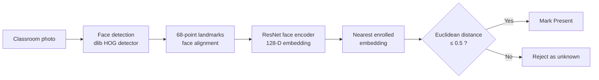
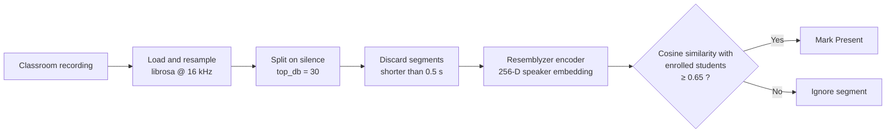
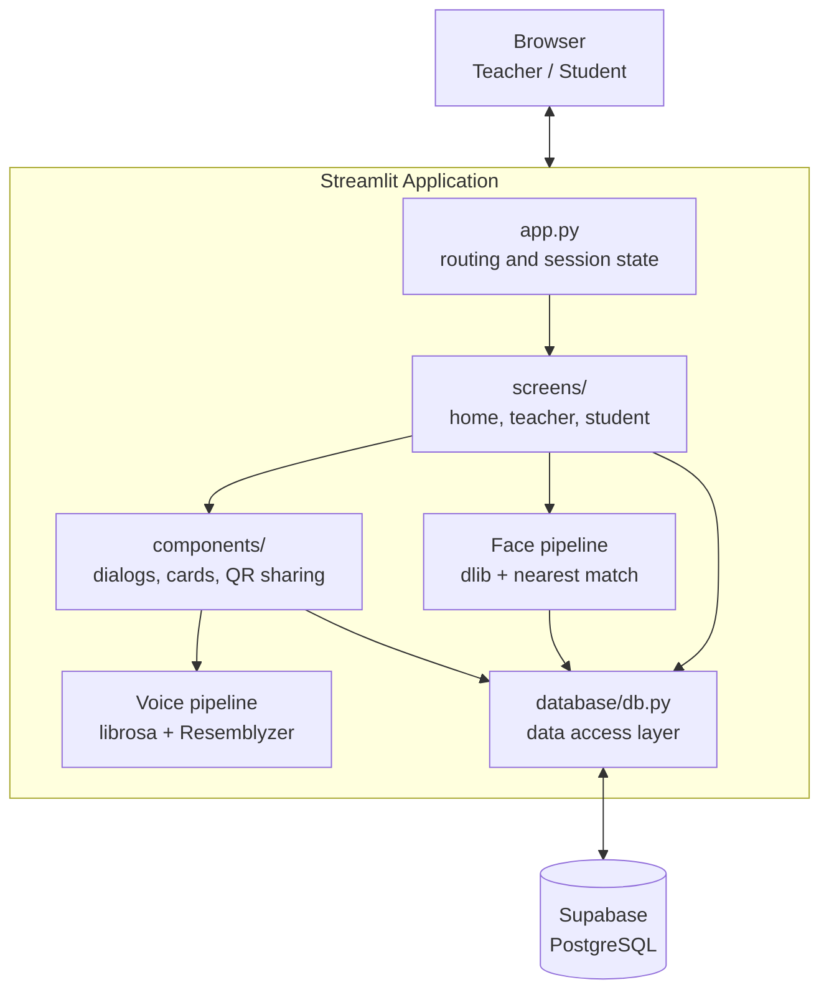
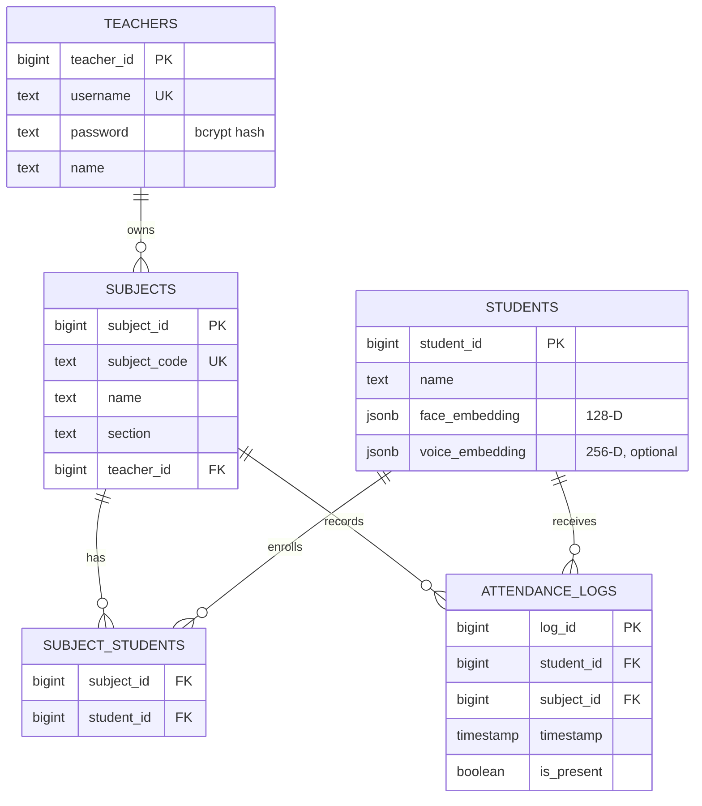
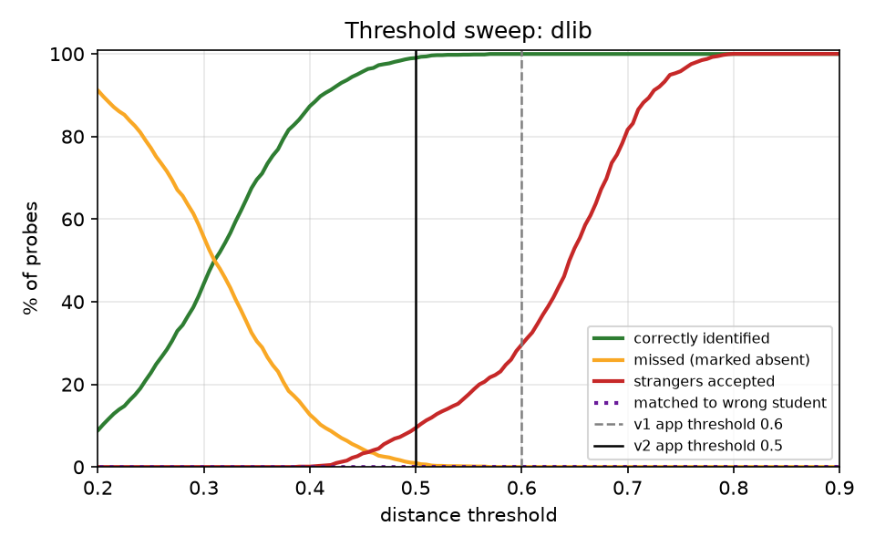
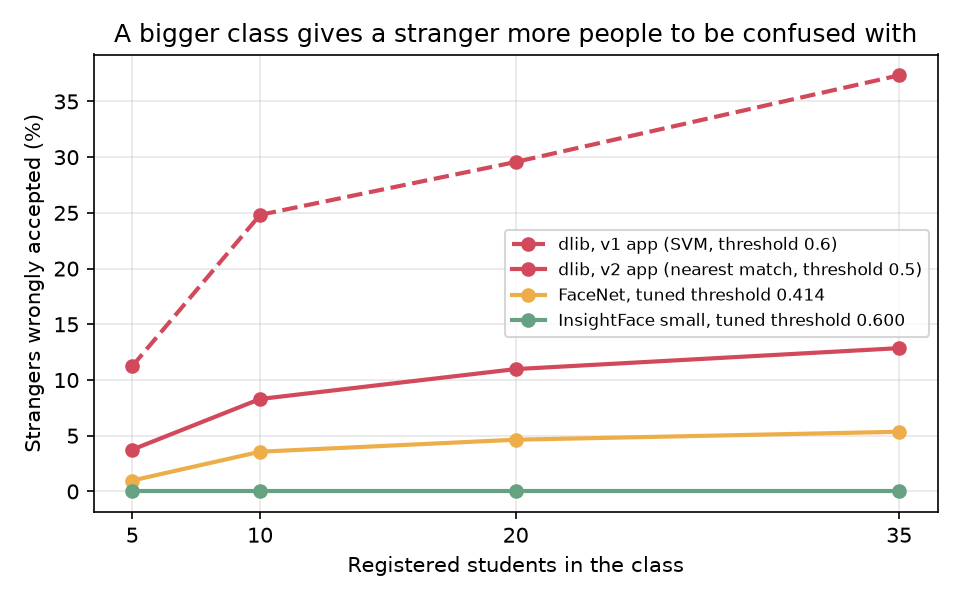

<div align="center">


# SnapClass

### AI-powered classroom attendance using face and voice recognition

Take attendance for an entire class from **a single photo** or **a short voice recording**, in seconds instead of minutes.

[](https://www.python.org/)
[](https://streamlit.io/)
[](https://supabase.com/)
[](http://dlib.net/)
[](eval/README.md)
[](https://github.com/resemble-ai/Resemblyzer)

**[Live Demo](https://snapclass-proj.streamlit.app)**

</div>

---

## Table of Contents

- [Overview](#overview)
- [Key Features](#key-features)
- [How the AI Works](#how-the-ai-works)
  - [Face Recognition Pipeline](#1-face-recognition-pipeline)
  - [Voice Recognition Pipeline](#2-voice-recognition-pipeline)
- [System Architecture](#system-architecture)
- [Tech Stack](#tech-stack)
- [Database Schema](#database-schema)
- [Project Structure](#project-structure)
- [Getting Started](#getting-started)
- [Usage](#usage)
- [Evaluation and Benchmarks](#evaluation-and-benchmarks)
- [How the Project Evolved](#how-the-project-evolved)
- [Design Decisions](#design-decisions)
- [Limitations and Roadmap](#limitations-and-roadmap)

---

## Overview

Manual roll calls waste 5–10 minutes of every lecture and are easy to game through proxy attendance. **SnapClass** replaces that process with computer vision and speech AI:

- A **teacher** captures or uploads one or more classroom photos. SnapClass detects every face, identifies each enrolled student, and produces a Present/Absent report that the teacher reviews before saving.
- When photos are not practical (poor lighting, faces hidden), the teacher can **record students saying "I am present"**, and SnapClass identifies each speaker by voice.
- **Students log in with their face** instead of a password, and new students are registered on the spot.

The system stores **only numerical embeddings, never raw photos or audio**, which keeps it lightweight and privacy-conscious.

<!-- Add screenshots or a GIF of the app here, for example:
<p align="center">
  
  
</p>
-->

---

## Key Features

### For Teachers
- **Secure accounts:** username/password authentication with **bcrypt** password hashing.
- **Subject management:** create subjects with a code, name, and section, and track enrolled students and classes held.
- **Photo attendance:** capture photos with the camera or upload multiple images. Each student is matched across all photos, and the report shows which photo they were found in.
- **Voice attendance:** record the classroom once, and each speaker is identified automatically.
- **Human-in-the-loop review:** every AI result is shown as a table to **confirm or discard** before anything is written to the database.
- **One-tap sharing:** a **QR code** and join link (`?join-code=<CODE>`) for each subject let students enroll instantly.
- **Attendance records:** a history of every session with a present/total count, newest first.

### For Students
- **FaceID login:** passwordless sign-in using face recognition.
- **On-the-spot registration:** an unrecognised face triggers sign-up with **optional voice enrollment**.
- **Enrollment:** join a subject by entering its code or by scanning the teacher's QR code.
- **Personal dashboard:** total and attended classes for every enrolled subject, plus the option to unenroll.

---

## How the AI Works

Both pipelines follow the same idea: a **pretrained deep learning model** converts a face or voice into an **embedding**, a fixed-length vector in which samples from the same person lie close together and samples from different people lie far apart. Recognition then becomes a distance comparison, so **a single sample per student is enough to enroll them (one-shot enrollment)**, and no deep model needs to be retrained.

### 1. Face Recognition Pipeline

`src/pipelines/face_pipeline.py` and `src/pipelines/face_matching.py`



| Stage | Implementation |
|---|---|
| **Detection** | `dlib.get_frontal_face_detector()` finds every face in the image (upsampled once to catch smaller faces). |
| **Alignment** | A 68-point shape predictor locates the eyes, nose, mouth, and jawline to normalise pose. |
| **Embedding** | dlib's pretrained ResNet model (`face_recognition_model_v1`) outputs a **128-dimensional** face descriptor. |
| **Matching** | Each face embedding is compared with every registered student's stored embedding by **Euclidean distance**, and the nearest student is taken. |
| **Open-set rejection** | The match is accepted only if the distance is at most **0.5**. Anything farther is treated as an unknown face. The value comes from the [benchmark](#evaluation-and-benchmarks), not from the library default. |
| **Caching** | The dlib models and the list of student embeddings are cached with `@st.cache_resource`. A new registration refreshes only the student list, so the models stay loaded. |

The same pipeline powers **FaceID login**, which requires exactly one face in the frame.

The first version used a linear SVM and dlib's default threshold of 0.6. Both were changed after measurement; see [How the Project Evolved](#how-the-project-evolved).

### 2. Voice Recognition Pipeline

`src/pipelines/voice_pipeline.py`



| Stage | Implementation |
|---|---|
| **Pre-processing** | `librosa` loads the audio at 16 kHz, and Resemblyzer's `preprocess_wav` normalises volume and trims silence. |
| **Segmentation** | `librosa.effects.split` separates individual utterances at the pauses between speakers. |
| **Embedding** | Resemblyzer's pretrained `VoiceEncoder` produces an L2-normalised **256-dimensional** speaker embedding that captures *who* is speaking, independent of *what* is said. |
| **Matching** | Each segment is compared only against **students enrolled in the selected subject**, using cosine similarity (a dot product of normalised vectors), with a **0.65** acceptance threshold. The best score per student is kept. |

---

## System Architecture



- **Presentation:** Streamlit screens and dialogs, with state managed through `st.session_state` and deep links through `st.query_params`.
- **AI layer:** isolated pipeline modules that turn images and audio into embeddings and identities.
- **Data layer:** a thin data-access module over the Supabase Python client, with credentials loaded from Streamlit secrets.

---

## Tech Stack

| Category | Technology | Purpose |
|---|---|---|
| **Frontend and app server** | Streamlit | UI, camera and microphone capture, dialogs, session state |
| **Database** | Supabase (PostgreSQL) | Users, subjects, enrollments, embeddings, attendance logs |
| **Face AI** | dlib, face_recognition_models | Face detection, landmarks, 128-D embeddings |
| **Evaluation** | scikit-learn, matplotlib, FaceNet, InsightFace | Benchmark in `eval/` (not installed with the app) |
| **Voice AI** | Resemblyzer (PyTorch), librosa | Speaker embeddings, audio loading and segmentation |
| **Data processing** | NumPy, pandas | Vector math, attendance aggregation and reports |
| **Security** | bcrypt | Salted password hashing |
| **Utilities** | Pillow, segno | Image handling, QR code generation |

---

## Database Schema



<details>
<summary><b>SQL to create the tables in Supabase</b></summary>

Run this in the Supabase **SQL Editor**:

```sql
create table teachers (
  teacher_id  bigint generated always as identity primary key,
  username    text unique not null,
  password    text not null,
  name        text not null,
  created_at  timestamptz default now()
);

create table students (
  student_id       bigint generated always as identity primary key,
  name             text not null,
  face_embedding   jsonb,
  voice_embedding  jsonb,
  created_at       timestamptz default now()
);

create table subjects (
  subject_id    bigint generated always as identity primary key,
  subject_code  text unique not null,
  name          text not null,
  section       text,
  teacher_id    bigint references teachers(teacher_id) on delete cascade
);

create table subject_students (
  subject_id  bigint references subjects(subject_id) on delete cascade,
  student_id  bigint references students(student_id) on delete cascade,
  primary key (subject_id, student_id)
);

create table attendance_logs (
  log_id      bigint generated always as identity primary key,
  student_id  bigint references students(student_id) on delete cascade,
  subject_id  bigint references subjects(subject_id) on delete cascade,
  timestamp   timestamp not null,
  is_present  boolean not null default false
);
```

</details>

---

## Project Structure

```
snapclass/
├── app.py                          # Entry point: page config, routing, QR deep-link handling
├── requirements.txt
├── eval/                           # Face recognition benchmark (not used by the app)
│   ├── README.md                   # Method, results and findings
│   ├── models.py                   # dlib, FaceNet and InsightFace behind one interface
│   ├── evaluate.py                 # Metrics, tables and plots
│   ├── check_app.py                # Runs the app's real face pipeline on the dataset
│   └── results/                    # Result tables (.md, .csv) and plots (.png)
└── src/
    ├── database/
    │   ├── config.py               # Supabase client (reads Streamlit secrets)
    │   └── db.py                   # Data-access layer and bcrypt helpers
    ├── pipelines/
    │   ├── face_pipeline.py        # Detection → embedding → cached student index
    │   ├── face_matching.py        # Nearest match with distance threshold (no Streamlit/DB imports)
    │   └── voice_pipeline.py       # Segmentation → speaker embedding → similarity matching
    ├── screens/
    │   ├── home_screen.py          # Role selection (student / teacher)
    │   ├── teacher_screen.py       # Login, registration, dashboard tabs
    │   └── student_screen.py       # FaceID login, registration, dashboard
    ├── components/
    │   ├── dialog_add_photo.py     # Camera capture / multi-image upload
    │   ├── dialog_attendance_results.py  # Review and confirm attendance
    │   ├── dialog_voice_attendance.py    # Voice-based attendance
    │   ├── dialog_create_subject.py
    │   ├── dialog_share_subject.py # QR code and join link
    │   ├── dialog_enroll.py        # Enroll by subject code
    │   ├── dialog_auto_enroll.py   # Enroll from QR / join link
    │   ├── subject_card.py
    │   ├── header.py
    │   └── footer.py
    └── ui/
        └── base_layout.py          # Global styling and theme
```

---

## Getting Started

### Prerequisites
- **Python 3.12 or newer**
- A free [Supabase](https://supabase.com/) project
- A webcam and microphone (for the camera and voice features)

### 1. Clone the repository
```bash
git clone https://github.com/<your-username>/<your-repo>.git
cd <your-repo>
```

### 2. Create a virtual environment and install dependencies
```bash
python -m venv venv
source venv/bin/activate        # Windows: venv\Scripts\activate
pip install -r requirements.txt
```

> `dlib-bin` provides prebuilt dlib wheels, so no C++ compilation is needed on most platforms. `setuptools<70` is pinned because `face_recognition_models` relies on `pkg_resources`.

### 3. Set up the database
Create the tables using the SQL in [Database Schema](#database-schema).

### 4. Add your Supabase credentials
Create `.streamlit/secrets.toml` in the project root:
```toml
SUPABASE_URL = "https://<your-project>.supabase.co"
SUPABASE_KEY = "<your-supabase-key>"
```
> Never commit this file. Add `.streamlit/secrets.toml` to your `.gitignore`.

### 5. Run the app
```bash
streamlit run app.py
```
The app opens at `http://localhost:8501`.

---

## Usage

1. **Teacher:** choose *Teacher Portal*, register, and log in.
2. **Create a subject** under *Manage Subjects*, then use *Share Code* to show the QR code or link.
3. **Student:** choose *Student Portal* and take a photo. New students enter their name and can optionally record a short phrase for voice enrollment.
4. **Student enrolls** by scanning the QR code or entering the subject code.
5. **Teacher takes attendance** under *Take Attendance*:
   - **Photo mode:** add one or more classroom photos, then select *Run Face Analysis*.
   - **Voice mode:** select *Use Voice Attendance* and record students saying "I am present" one after another.
6. **Review** the generated report, then select *Confirm & Save*.
7. View past sessions under *Attendance Records*.

---

## Evaluation and Benchmarks

The face pipeline was benchmarked on the public [Georgia Tech Face Database](https://www.anefian.com/research/face_reco.htm) (50 people, 748 unique photos) and compared with FaceNet and InsightFace (ArcFace). The protocol mirrors the app: each student is enrolled from **one photo**, and the system must also reject people who were never registered. Thresholds of the compared models are tuned on one half of the people and tested on the other half, over 10 runs.

| Pipeline | Registered students correctly identified | Strangers wrongly accepted | Time per photo (CPU) |
|---|---|---|---|
| Version 1 of the app (dlib, SVM, threshold 0.6) | 99.96% | 29.6% | 226 ms |
| **Current app** (dlib, nearest match, threshold 0.5) | 99.0% | 9.5% | 226 ms |
| FaceNet (tuned threshold) | 99.6% | 7.0% | 109 ms |
| InsightFace ArcFace, small (tuned threshold) | 100% | 0% | 43 ms |
| InsightFace ArcFace, large (tuned threshold) | 100% | 0% | 560 ms |

<p align="center">
  
  
</p>

**What the benchmark showed**

- **Registered students were recognised almost perfectly**, but dlib's default threshold of 0.6 was too loose for rejecting strangers. It was designed for comparing one pair of faces, while the app compares each face with every registered student.
- **Stranger acceptance grows with class size.** At 0.6 it went from 11% with 5 registered students to 37% with 35. At 0.5 it goes from 4% to 13%.
- **The SVM was redundant.** With one enrollment photo per student it made the same prediction as nearest-neighbour matching on all 3,560 test photos.
- **InsightFace's small ArcFace model** separated students from strangers perfectly on this dataset and ran about 5× faster than dlib on CPU.

The app was changed in response; the next section describes how. `eval/check_app.py` runs the app's real `face_pipeline.py` on the dataset, with only the database replaced, and confirms that the app produces the numbers reported here.

These results come from a small, clean research dataset, so they compare models under identical conditions and do not predict accuracy in a real classroom. Method, full results, limitations and steps to reproduce are in [`eval/README.md`](eval/README.md).

---

## How the Project Evolved

The face matching was redesigned after it was measured. The steps are recorded here because the reasons matter as much as the final code.

### Version 1: SVM and dlib's default threshold

Each face embedding went to a **linear SVM** trained on all students' embeddings, which predicted the most likely student. The prediction was accepted if the Euclidean distance to that student's stored embedding was at most **0.6**.

The reasoning at the time: an SVM is a standard classifier for embeddings, an SVM alone can never say "nobody", so a distance check was added to reject unknown faces, and 0.6 is the threshold dlib documents for its model.

### Measuring it

The [benchmark](#evaluation-and-benchmarks) tested that design the way the app uses it: one photo per student, with strangers among the test photos. Three results changed the design:

1. Version 1 identified 99.96% of registered students but accepted **29.6% of photos of unregistered people**, rising to 37% for a class of 35.
2. The SVM chose the same student as nearest-neighbour matching on **all 3,560 test photos**, for every model tested.
3. No dlib threshold gave both low stranger acceptance and no missed students.

### Version 2: nearest match at threshold 0.5

**The SVM was removed.** Faces are now matched to the nearest stored embedding.

- *Evidence:* identical predictions on every test photo, so it added no accuracy.
- *Why they are identical:* with one embedding per student, the widest-margin boundary between two students is the perpendicular bisector between their two points. Each pairwise SVM therefore asks "which of these two is closer?", and the vote over all pairs selects the nearest embedding.
- *What it cost:* the SVM was retrained after every registration, and that step cleared every cached model, so the dlib and voice models loaded again. It trained one classifier per pair of students, which is 499,500 classifiers for 1,000 students. It needed a special case when only one student existed. It ran an internal cross-validation (`probability=True`) whose output was never used.
- *When an SVM would help:* with several photos per student, it could learn from the variation between them. The app enrolls from one photo.

**The threshold was lowered from 0.6 to 0.5.**

- *Evidence:* stranger acceptance fell from 29.6% to 9.5% in the benchmark.
- *Why 0.6 was too loose:* it is meant for deciding whether one pair of faces match. Comparing a stranger with every registered student gives one chance of a false match per student, and those chances add up.
- *Why not lower:* at 0.45, stranger acceptance is 3.3% but 4.3% of genuine students are missed. At 0.5, 1.0% are missed.
- *Trade-off accepted:* about 1 in 100 photos of a registered student is no longer recognised. A student counts as present if any of the teacher's photos matches, so taking two or three photos reduces this. On the login screen, an unrecognised face now gets a message asking registered students to retake the photo before registering again, to avoid duplicate accounts.

**Registration refreshes only the student list.** The dlib and voice models stay in memory.

**The matching code moved to its own module**, `src/pipelines/face_matching.py`, with no Streamlit or database imports. The benchmark imports that module and reads the threshold from it, so the published numbers are produced by the code the app runs.

| | Version 1 | Version 2 |
|---|---|---|
| Strangers accepted, 18 registered students | 29.6% | 9.5% |
| Strangers accepted, 35 registered students | 37.3% | 12.9% |
| Registered students correctly identified | 99.96% | 99.0% |
| Composite classroom photos: present students marked present | 372 of 372 | 362 of 372 |
| Composite classroom photos: students wrongly marked present | 14 | 8 |
| Work after each registration | Retrain SVM, reload dlib and voice models | Refresh the student list |

Stored embeddings did not change, so no student had to register again.

### Considered and rejected: matching only against the subject's enrolled students

Comparing a classroom face only with students enrolled in that subject would give strangers fewer people to be confused with. It was rejected because of students who are registered but not enrolled in the subject, such as someone from another section. Today such a face matches its own record and is then ignored for not being enrolled. Under subject-only matching, that face could only match an enrolled student and might mark them present.

### Next step: InsightFace ArcFace

Version 2 still accepts about 1 stranger photo in 10 in the benchmark, which is a limit of the dlib embeddings and not of the threshold. InsightFace's small ArcFace model accepted none, identified every registered student, and was about 5× faster on CPU. It has not been adopted yet because:

- **Every student would have to register again.** Its embeddings have 512 numbers and dlib's have 128, so stored embeddings cannot be converted.
- **Licence.** InsightFace's pretrained models are released for non-commercial research use.
- **The benchmark is too easy to prove it.** A perfect score on 50 people in clean photos shows InsightFace is better than dlib here, not that it makes no errors. It should be tested on harder photos first.
- **Deployment is untested.** Its memory use on the hosting tier the app runs on has not been measured.

---

## Design Decisions

- **Pretrained embeddings over custom training:** using a pretrained face encoder and speaker encoder gives strong accuracy with **one sample per student** and no GPU training.
- **Nearest match with a measured threshold:** a face is matched to the nearest stored embedding and rejected if it is farther than 0.5. The threshold was chosen from a benchmark of the app's own use case instead of the library default.
- **Faces are matched against all registered students, then filtered by enrollment:** a registered student from another class matches their own record and is ignored, instead of being forced onto an enrolled student.
- **Matching logic separated from the app framework:** `face_matching.py` has no Streamlit or database imports, so the benchmark can run the exact code the app uses.
- **Embeddings only:** no photos or recordings are persisted, reducing storage and protecting student privacy.
- **Subject-scoped voice matching:** comparing voices only against students enrolled in the selected subject shrinks the search space and reduces false matches.
- **Human in the loop:** AI output is always reviewed by the teacher before it is saved.
- **Model caching:** heavy models load once per server process with `st.cache_resource`, keeping interactions fast.

---

## Limitations and Roadmap

| Current limitation | Planned improvement |
|---|---|
| About 10% of stranger photos are still accepted in the benchmark | Move to InsightFace ArcFace after testing it on harder photos (requires re-enrolling students) |
| About 1% of registered students' photos are not recognised at threshold 0.5 | Store multiple embeddings per student across angles and lighting |
| No liveness check (a printed photo could pass face login) | Add liveness / anti-spoofing detection (blink or depth cues) |
| Benchmark uses a small research dataset; voice is not evaluated | Evaluate on classroom photos collected with consent, and benchmark the voice pipeline |
| Overlapping speakers merge into one audio segment | Speaker diarization for simultaneous speech |
| Linear scan over stored embeddings | Vector search with `pgvector` for large institutions |
| Timestamps stored in server time | Timezone-aware timestamps |
| Open database access through the app key | Supabase Row Level Security policies |
| — | Export attendance reports to CSV/Excel and attendance analytics |

---

<div align="center">

If you found this project useful, consider giving it a ⭐

</div>
