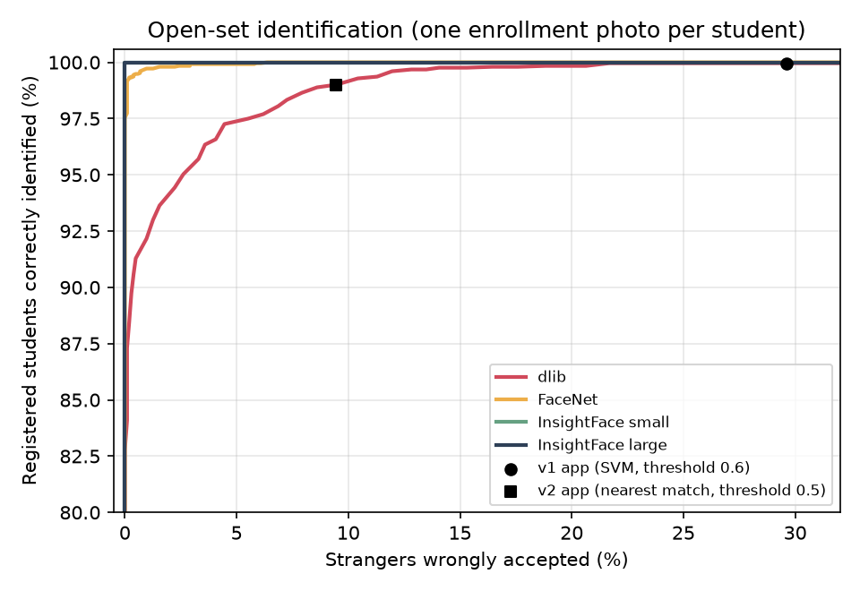
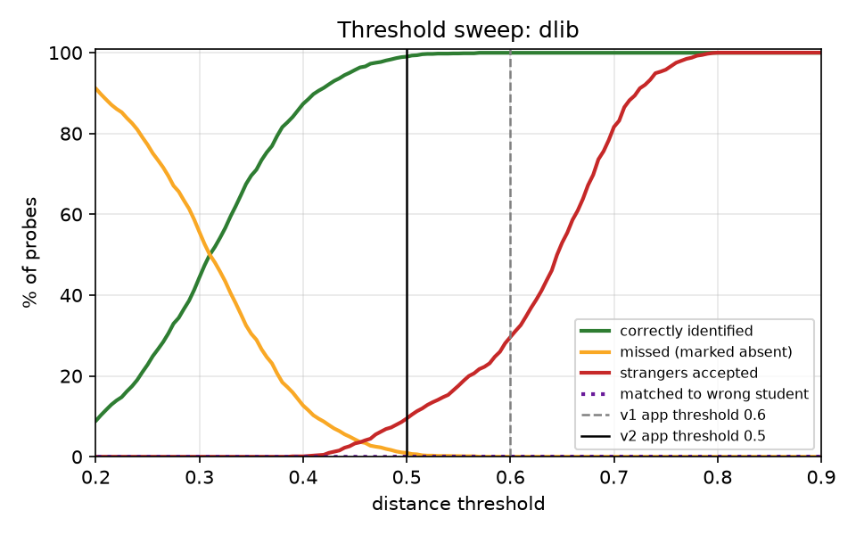
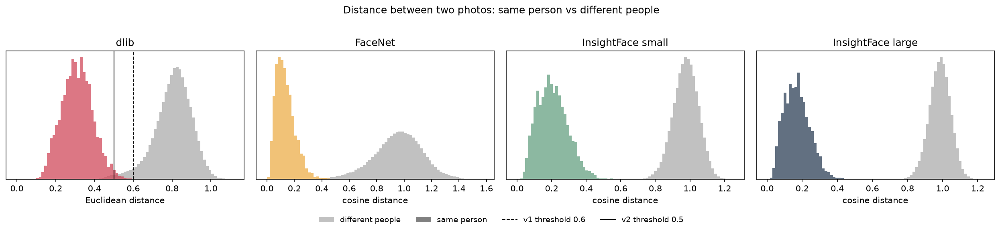
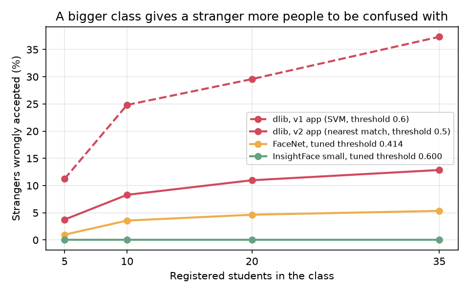

# Face Recognition Benchmark

This folder measures how well SnapClass's face matching works, compares it with two other face recognition models, and records the changes the measurements led to. Nothing here is imported by `app.py`, and its dependencies are not in the root `requirements.txt`.

**Two versions of the app are measured**

| | Matching | Threshold |
|---|---|---|
| **v1** (original) | A linear SVM picks a student; accepted if the Euclidean distance to that student's embedding is within the threshold | 0.6, dlib's default |
| **v2** (current) | The nearest enrolled embedding; accepted if its distance is within the threshold | 0.5, chosen from this benchmark |

**Questions answered**

1. How accurate was v1?
2. Was 0.6 the right threshold?
3. Did the SVM add anything over plain nearest-neighbour matching?
4. Would a different model do better, and at what cost in speed?
5. Does v2, as implemented in the app, deliver the improvement the benchmark predicts?

## Summary of findings

| | Registered students correctly identified | Strangers wrongly accepted | Time per photo (CPU) |
|---|---|---|---|
| v1 app (dlib, SVM, threshold 0.6) | 99.96% | **29.6%** | 226 ms |
| **v2 app** (dlib, nearest match, threshold 0.5) | 99.0% | **9.5%** | 226 ms |
| FaceNet (tuned threshold) | 99.6% | 7.0% | 109 ms |
| InsightFace ArcFace, small (tuned threshold) | 100% | 0% | 43 ms |
| InsightFace ArcFace, large (tuned threshold) | 100% | 0% | 560 ms |

- **v1 recognised registered students almost perfectly, but threshold 0.6 was too loose for rejecting strangers.** With 18 registered students, 29.6% of photos of unregistered people were accepted as some student. That matters most for FaceID login, where an unregistered person should never get in.
- **The problem grows with class size.** A stranger is compared with every registered student, so more students means more chances of a false match: at 0.6, 11% with 5 students and 37% with 35.
- **Lowering the dlib threshold is a trade-off, not a fix.** At 0.5, stranger acceptance drops to 9.5% while 1% of genuine students are missed. No dlib threshold gives both low stranger acceptance and no misses. v2 uses 0.5.
- **The SVM was redundant.** On all 3,560 probes it picked exactly the same student as nearest-neighbour matching. With one enrollment photo per student, each pairwise linear SVM is the perpendicular bisector between two embeddings, so the vote always selects the nearest embedding. v2 removes it.
- **InsightFace (ArcFace) separated registered students from strangers perfectly on this dataset**, and its small model is about 5× faster than dlib on CPU. It is the planned next step, not yet adopted.
- All detectors found every face, including faces about 50 px wide in composite classroom photos, so this dataset does not differentiate the detectors. dlib's CNN detector gave no benefit here and took 37–41 s per group photo, against 2–4 s for the HOG detector.

These numbers come from a small, clean research dataset. Treat them as a comparison under identical conditions, not as the accuracy to expect in a real classroom. See [Limitations](#limitations).

## Dataset

[Georgia Tech Face Database](https://www.anefian.com/research/face_reco.htm): 50 people, 15 colour photos each (640×480), taken in two or three sessions in 1999 at the Center for Signal and Image Processing, Georgia Institute of Technology, with varied expression, lighting, scale and head tilt. Each photo comes with a manually labelled face box. Published by Ara V. Nefian for research.

- Two photos are pixel-identical copies of others (`s19/14` = `s19/08`, `s19/15` = `s19/11`). They are dropped, leaving **748 unique photos**.
- The images are not stored in this repository. `download_data.py` fetches them.

## Method

The protocol mirrors how the app is used.

**One-shot enrollment, open set.** Each registered student is enrolled from one photo, as in the app. The system is then shown (a) the other photos of registered students and (b) photos of people who were never registered. Four outcomes are counted:

| Outcome | Meaning in the app |
|---|---|
| Correctly identified | Student marked present |
| Missed | Student is there but marked absent |
| Wrong student | Student marked present under someone else's name |
| Stranger accepted | An unregistered person is taken for a student |

**Identity-disjoint tuning.** The 50 people are split into two halves of 25. In each half, 18 are registered and 7 are strangers. A compared model's threshold is tuned on one half and tested on the other, then the halves swap. This is repeated for 5 random seeds, giving 10 test runs. Thresholds are therefore never tested on people they were tuned on. The two app versions use fixed thresholds (0.6 and 0.5), need no tuning, and are evaluated on the same 10 test runs.

**Tuning rule.** Highest correct-identification rate such that at most 1% of strangers are accepted and at most 1% of students are matched to the wrong person. When several thresholds tie, the middle one is used.

**Same enrollment photos for every model.** Every model found the face in all 748 photos, so all models enroll each student from the same randomly chosen photo.

**v2 is measured through the app's own code.** `evaluate.py` imports `match_face` and `match_faces` from `src/pipelines/face_matching.py` and reads the threshold from there.

**Models**

| Name | Detector | Embedding | Distance |
|---|---|---|---|
| dlib (used by the app) | HOG, 1× upsampling | ResNet, 128-D | Euclidean |
| FaceNet | MTCNN | InceptionResnetV1 (VGGFace2), 512-D | Cosine |
| InsightFace small (`buffalo_s`) | SCRFD-500M | MobileFaceNet ArcFace, 512-D | Cosine |
| InsightFace large (`buffalo_l`) | SCRFD-10G | ResNet-100 ArcFace, 512-D | Cosine |

The dlib wrapper computes embeddings the same way as `get_face_embeddings` in the app (`num_jitters=1`), and the v1 rule uses the classifier the app used, `SVC(kernel='linear', probability=True, class_weight='balanced')`. All models are used pretrained; nothing is trained or fine-tuned here.

**Composite classroom photos.** The dataset has one person per photo, so `build_group_photos.py` tiles photos into 1280×960 images: 10 with 16 people (faces about 75 px) and 10 with 36 people (faces about 50 px), mixing 35 registered students and 15 strangers. These are synthetic and test many small faces per image, not occlusion or people looking away.

## Results

Full tables are in [`results/summary.md`](results/summary.md); raw numbers are in the CSV files next to it.

### 1. Open-set identification

Mean ± standard deviation over the 10 test runs.

| Pipeline | Threshold | Correctly identified | Missed | Wrong student | Strangers accepted |
|---|---|---|---|---|---|
| dlib, v1 app (SVM + distance check) | 0.6 (fixed) | 99.96% ± 0.1 | 0.0% ± 0.0 | 0.04% ± 0.1 | 29.6% ± 16.3 |
| dlib, v2 app (nearest match) | 0.5 (fixed) | 99.0% ± 0.5 | 1.0% ± 0.5 | 0.04% ± 0.1 | 9.5% ± 13.8 |
| dlib, nearest match | 0.480 ± 0.052 (tuned) | 96.3% ± 4.4 | 3.7% ± 4.4 | 0.0% ± 0.0 | 10.1% ± 14.5 |
| FaceNet, nearest match | 0.415 ± 0.062 (tuned) | 99.6% ± 0.6 | 0.4% ± 0.6 | 0.0% ± 0.0 | 7.0% ± 10.2 |
| InsightFace small, nearest match | 0.600 ± 0.022 (tuned) | 100.0% ± 0.0 | 0.0% ± 0.0 | 0.0% ± 0.0 | 0.0% ± 0.0 |
| InsightFace large, nearest match | 0.588 ± 0.019 (tuned) | 100.0% ± 0.0 | 0.0% ± 0.0 | 0.0% ± 0.0 | 0.0% ± 0.0 |

dlib thresholds are Euclidean distances; FaceNet and InsightFace thresholds are cosine distances, so they are not comparable across models.

For dlib and FaceNet, a threshold tuned to accept at most 1% of strangers on one group of people accepted 7–10% on the other, with a large spread between runs. Their thresholds do not transfer reliably, because a few look-alike pairs dominate the errors. InsightFace's did transfer.



### 2. dlib at different thresholds

| Threshold | Correctly identified | Missed | Strangers accepted |
|---|---|---|---|
| 0.40 | 87.3% | 12.7% | 0.1% |
| 0.45 | 95.7% | 4.3% | 3.3% |
| 0.50 (v2 app) | 99.0% | 1.0% | 9.5% |
| 0.55 | 99.8% | 0.2% | 17.6% |
| 0.60 (v1 app) | 99.96% | 0.0% | 29.6% |



dlib's 0.6 was designed for comparing **one pair** of faces. In the app, each face is compared against **every** registered student, so the chance that a stranger falls within the threshold of at least one of them adds up.

0.5 was chosen for v2 because it is the lowest of these thresholds that still recognises about 99% of registered students. Going to 0.45 would cut stranger acceptance further but miss more than 4% of genuine students.

### 3. Why: distance distributions



For dlib, same-person and different-person distances overlap between about 0.35 and 0.6: 3.7% of different-person pairs are closer than 0.6. For InsightFace the two groups do not overlap at all on this dataset. The large model leaves a wider gap (largest same-person distance 0.44, smallest different-person distance 0.60) than the small one (0.55 and 0.61), so it has more safety margin on harder photos.

| Model | ROC AUC | Equal error rate | True accepts at 0.1% false accepts |
|---|---|---|---|
| dlib | 0.9996 | 0.93% | 93.0% |
| FaceNet | 1.0000 | 0.27% | 99.4% |
| InsightFace small | 1.0000 | 0.00% | 100.0% |
| InsightFace large | 1.0000 | 0.00% | 100.0% |

### 4. Class-size effect

Share of photos of 15 strangers accepted, as the number of registered students grows.

| Setting | 5 students | 10 students | 20 students | 35 students |
|---|---|---|---|---|
| dlib, v1 app (SVM, threshold 0.6) | 11.2% | 24.8% | 29.6% | 37.3% |
| dlib, v2 app (nearest match, threshold 0.5) | 3.8% | 8.3% | 11.0% | 12.9% |
| FaceNet, threshold 0.414 | 1.0% | 3.6% | 4.6% | 5.4% |
| InsightFace small, threshold 0.600 | 0.0% | 0.0% | 0.0% | 0.0% |



The app matches every face against all students in the database, so this effect applies to the whole user base. The FaceNet and InsightFace thresholds in this table are the medians from experiment 1 and were tuned on overlapping people; the two dlib rows use fixed thresholds and are fully independent.

### 5. Was the SVM needed?

| Model | Probes | Same prediction as nearest neighbour |
|---|---|---|
| dlib | 3,560 | 3,560 (100%) |
| FaceNet | 3,560 | 3,560 (100%) |
| InsightFace small | 3,560 | 3,560 (100%) |
| InsightFace large | 3,560 | 3,560 (100%) |

Removing the SVM gives identical decisions at any given threshold, removes the retraining step after every registration, and removes a training cost that grows with the square of the number of students.

### 6. Speed and composite classroom photos

Measured on a 2-core cloud CPU without a GPU.

| Model | Single photo (640×480) | 16-person photo | 36-person photo |
|---|---|---|---|
| dlib HOG (used by the app) | 226 ms | 2.0 s | 4.0 s |
| dlib CNN detector | not measured | 36.6 s | 40.8 s |
| FaceNet | 109 ms | 0.8 s | 1.4 s |
| InsightFace small | 43 ms | 0.3 s | 0.7 s |
| InsightFace large | 560 ms | 4.9 s | 10.8 s |

| Pipeline | Faces found | Present students marked present | Students wrongly marked present |
|---|---|---|---|
| dlib HOG, v1 app (SVM, threshold 0.6) | 520/520 | 372/372 | 14 |
| dlib HOG, v2 app (nearest match, threshold 0.5) | 520/520 | 362/372 | 8 |
| dlib CNN detector, v1 rule (threshold 0.6) | 520/520 | 369/372 | 14 |
| FaceNet, threshold 0.414 | 520/520 | 369/372 | 7 |
| InsightFace small, threshold 0.600 | 520/520 | 372/372 | 0 |
| InsightFace large, threshold 0.589 | 520/520 | 372/372 | 0 |

Totals over the 20 composite photos. "Wrongly marked present" counts registered students who were not in the photo but were marked present because another face matched them.

### 7. Errors of the two app versions

Counts over all 10 test runs: 3,560 probes, of which 2,514 are photos of registered students and 1,046 are photos of strangers. Every row is in [`results/failure_cases.csv`](results/failure_cases.csv).

| | Strangers accepted | Registered students rejected | Students matched to the wrong student |
|---|---|---|---|
| v1 app (SVM, threshold 0.6) | 309 | 0 | 1 |
| v2 app (nearest match, threshold 0.5) | 98 | 24 | 1 |

In v1, 68% of the accepted strangers had a distance between 0.5 and 0.6, which is why moving the threshold to 0.5 removes about two thirds of them. A few specific pairs of people account for many of the rest.

## What changed in the app

1. **Threshold lowered from 0.6 to 0.5** in `src/pipelines/face_matching.py`.
2. **SVM replaced by nearest-match.** The retraining step after registration is gone; only the cached student list is refreshed, so the dlib and voice models stay loaded.
3. **Login message.** Because v2 rejects about 1% of genuine students' photos, an unrecognised face now gets a message asking registered students to retake the photo before registering again.

Stored embeddings are unchanged, so no student has to register again.

**Not done: matching only against the selected subject's enrolled students.** It would give strangers fewer people to be confused with. But a registered student who is not enrolled in the subject currently matches their own record and is ignored; under subject-only matching that face could only match an enrolled student and might mark them present.

**Planned: InsightFace's small ArcFace model.** It was more accurate and faster here. It is not adopted yet because its 512-D embeddings would require every student to register again, its pretrained models are released for non-commercial research use, a perfect score on this easy dataset is not proof that it makes no errors, and its memory use on the app's hosting tier has not been measured.

## Checks on the app's real code

`check_app.py` imports `src/pipelines/face_pipeline.py` unchanged and replaces only the database with students built from dataset photos. Results are in [`results/app_checks.md`](results/app_checks.md).

| Check | Result |
|---|---|
| `match_face` equals the benchmark's decision at threshold 0.5 | 3,560 of 3,560 probes |
| At threshold 0.6, `match_face` equals the v1 SVM rule's decision | 3,560 of 3,560 probes |
| Students registered through `get_face_embeddings` get the benchmark's embeddings | Identical for all 18 |
| `predict_attendance` equals the benchmark on one full test split | 357 of 357 photos |
| `predict_attendance` on the 20 composite photos | 362/372 present, 8 wrongly present, as in the benchmark |
| A new registration is recognised after `refresh_face_index()` | Yes, and the dlib models are not reloaded |
| No students, and exactly one student | Both run without errors or special cases |

The app itself was not run end to end here, because that needs the Supabase database and a camera. The Streamlit screens are therefore covered by a syntax and undefined-name check only.

## Limitations

- **Small and easy dataset.** 50 people, mostly frontal, indoors, in one room, photographed in 1999. Perfect scores for InsightFace mean this dataset cannot separate the two InsightFace models or show their real error rate.
- **Not the deployment population.** The photos are not of Indian classrooms or phone and webcam captures. Real accuracy is likely to be lower for every model.
- **Few strangers per run.** Each test run has 7 strangers, so one look-alike pair moves the stranger-acceptance rate a lot. That is why its standard deviation is large.
- **0.5 was chosen on this dataset.** It was picked from the threshold table above, which uses all 50 people, so the v2 numbers are not from held-out people the way the tuned rows are.
- **Composite classroom photos are synthetic.** They do not include occlusion, motion blur, extreme angles or uneven lighting.
- **Detection was not stressed.** Every detector found every face, so the benchmark says nothing about which detector is better on hard images.
- **Face only.** The voice pipeline is not evaluated here.
- **No liveness test.** Whether a printed photo can pass is outside this benchmark.

## Reproducing

Tested on Python 3.13. The full run took about 40 minutes on a 2-core CPU, most of it the dlib CNN detector on the composite photos.

```bash
pip install -r eval/requirements-eval.txt
pip install --no-deps facenet-pytorch==2.6.0

python eval/download_data.py                        # dataset → eval/data/
python eval/extract_embeddings.py --phase singles   # run each model on 748 photos
python eval/build_group_photos.py                   # composite classroom photos
python eval/extract_embeddings.py --phase groups
python eval/evaluate.py                             # metrics, tables, plots → eval/results/
python eval/sanity_check.py                         # checks on the evaluation code
python eval/check_app.py                            # checks on the app's code (also needs streamlit)
```

All random choices are seeded, and running `evaluate.py` twice produces byte-identical CSV files.

**Sanity checks** ([`results/sanity_checks.md`](results/sanity_checks.md)): tune and test people never overlap; enrollment photos are never used as probes; random embeddings score at chance level; enrolling students under each other's names drops correct identification to 0%; each enrollment photo matches itself at distance 0.

## Files

| File | Purpose |
|---|---|
| `common.py` | Paths, dataset loading, data splits |
| `models.py` | One wrapper per face model, same interface |
| `download_data.py` | Fetches the dataset and face-box labels |
| `extract_embeddings.py` | Runs each model once per photo and caches the embeddings |
| `build_group_photos.py` | Builds the composite classroom photos |
| `evaluate.py` | Computes all metrics, tables and plots for v1, v2 and the compared models |
| `sanity_check.py` | Verifies the evaluation code |
| `check_app.py` | Runs the app's real face pipeline on the dataset |
| `requirements-eval.txt` | Benchmark-only dependencies |
| `results/` | Tables (`.md`, `.csv`) and plots (`.png`) |
